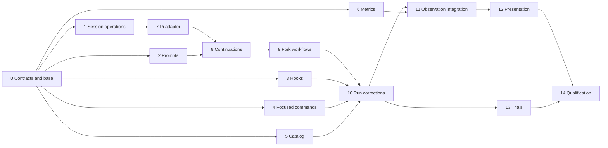

# Plan 23: session reuse and real-run corrections

**Date:** 2026-10-08. **Status:** authored for review; implementation has not
started. This plan implements the selected changes in both the
[session-reuse proposal](../../analysis/2026-10-08-session-reuse-and-system-prompts.md)
and the [status-badge real-run proposals](../../analysis/2026-10-08-status-badge-tone-real-run.md#proposals).

## Outcome

An ongoing agent keeps its orientation and conversation through ordinary
continuation. Side tasks use exact forks at predetermined points. Callers work
with session identities, numbered turns and high-level operations; persistence,
restoration, tool activation and request preservation stay behind the agent
boundary. Each task names its specialized submission tool, supplied once.

The same delivery fixes the real run's misleading shell checks, unusable focused
scenario commands, inconsistent authorization briefings, duplicated catalog and
prompt content, trial attribution and incomplete metrics. It records elapsed
time, exploration and actual token charges so a later comparison has the
evidence it needs. Architect judgment and configured audit health remain separate.

## Planning basis

- [Source state and architecture discovery](source-state.md) distinguishes
  committed behavior, concurrent staged work, stale generated evidence and
  implementation that still needs to be built.
- [Contracts](contracts.md) fix the interfaces between parallel workstreams.
- [Acceptance matrix](acceptance.md) names positive and negative controls.
- [Proposal coverage](proposal-coverage.md) accounts for every P1–P4 item and
  the session proposal, including explicit deferrals.
- [Iteration manifest](iterations/manifest.json) is the dependency graph;
  [execution rules](execution.md) define safe parallelism and integration.
- [Planning validation](planning-validation.md) records document validation,
  not passing implementation tests.

The authoring checkout is `/ramify`, branch `ramify-agent`, committed HEAD
`38b81e5e6814ad0980fbfa8d077bcec6cd91e56a`, with substantial staged and unstaged
work. In particular, scope-size and delivered-change corrections are already
staged. Preserve them and verify their remaining gaps; do not recreate an older
implementation from the analyses. Iteration 0 establishes the clean execution
base and captures which existing changes it includes. An isolated checkout must
not silently omit accepted fixes merely because they are not yet committed.

## Scope and decisions

Implement the accepted ordinary-continuation default, exact-prefix fork,
high-level session operations, handler rebinding and fixed workflow mapping.
Ignore legacy sessions completely. No automatic summary handoff, runtime strategy
selection, stage skipping or leading-prompt replacement is introduced.

Prioritize exploration/time and the existing scope-size metrics in this plan.
The separate [Plan 4](../04-token-efficiency/main-plan.md) score and its approval
remain separate; this plan provides reusable usage and attribution evidence but
does not implement or enable that score. No performance comparison, controlled
baseline or real-run measurement belongs to this plan; the user schedules any
comparison separately after delivery. A real run may be started only to debug
an integrated behavior when that is useful, and its records are not acceptance
evidence. The long `plan16-bounded-denials` live toolkit trial likewise remains
a separately scheduled follow-up.

For optional grep lockfile filtering, retain existing search semantics. Measure
search breadth and improve instructions; changing default exclusions needs a
separate declared search policy. All other concrete P1–P4 corrections are in scope.

## Owners

| Owner | Responsibility |
| --- | --- |
| Harness/agent | Public session-operation contract and scripted implementation |
| Harness/agent/pi | Exact provider transcript, native appended declarations, handler binding and final dispatch validation |
| Harness | Session storage through ledger, workflow policy, task construction, authorization, hooks, observations and projections |
| Harness/ledger | Existing durable append/effect primitives; no new run or session policy |
| Harness/plan-evidence and scenarios | Existing catalog and scenario form/identity contracts |
| Harness/audit and evidence | Existing configured execution and external evidence boundaries; retain provider ownership |
| Web | Render harness-owned session and metric projections |
| Root scripts/fixtures | Trial preparation and attribution checks |

No new module or toolkit release is selected. New consumer contracts must be
exposed by their existing owner with signature companions. Do not import toolkit
source, resurrect the removed scenario runner, or place durable writes in web.

## Iterations and dependencies

| ID | Deliverable | Depends on | Parallel opportunity |
| --- | --- | --- | --- |
| 0 | Reconcile base, freeze contracts, cases and ownership | — | Serial prerequisite |
| 1 | Durable session operations and scripted behavior | 0 | Alongside 2–6 |
| 2 | Stable role/task prompts and delivered manifests | 0 | Alongside 1, 3–6 |
| 3 | Correct and serialize mutation checks | 0 | Alongside other providers |
| 4 | Project-configured focused scenario commands | 0 | Alongside other providers |
| 5 | Catalog validation and scenario-form corrections | 0 | Alongside other providers |
| 6 | Scope-size corrections and exploration calculations | 0 | Alongside other providers |
| 7 | Pi prefix preservation and native appended tools | 1 | Alongside unfinished 2–6 |
| 8 | Integrate session operations and ordinary continuations | 2, 7 | Serial run-service integration |
| 9 | Integrate every predetermined fork and recovery path | 8 | After 8; providers may still run |
| 10 | Integrate command, catalog and briefing corrections | 3, 4, 5, 9 | After 9 |
| 11 | Capture metrics across all roles and publish projections | 6, 10 | Alongside 13 |
| 12 | Present session lineage, exploration, time and charges | 11 | Alongside 13 |
| 13 | Repair trial verification and fixture inputs | 10 | Alongside 11–12 |
| 14 | Qualify integrated behavior, transport and real-run improvement | 12, 13 | Serial final qualification |



Use separate worktrees for concurrent iterations and one integrator. Start any
ready iteration within available capacity; do not wait for a whole wave when a
dependency is already accepted. Parallel workers never edit `run/service.ts`,
shared record/protocol files or the test-boundary registry concurrently.
Iteration receipts qualify their named capability, not the unfinished whole plan.

## Verification and completion

Ordinary tests exercise real in-process behavior with scripted external answers,
following [testing.spec.md](../../testing.spec.md). Each iteration lists focused
selectors and independently expected outcomes. Native Cucumber, Git and provider
claims receive separate exact witnesses; scripted tests do not establish them.

From `ramify-agent/`, focused ordinary checks use:

```sh
npm run test:quick -- <exact files named by the iteration>
```

Iteration 0 runs the complete configured audit once on the committed execution
base, and the final clean committed candidate receives it again, from the
repository root:

```sh
ramify-agent/node_modules/.bin/ramify-audit audit --project-root ramify-agent --cwd . --full --nested --json
```

Final qualification also exercises a real supported pi transport, including
continuation, fork, tool addition and restoration. Retain serialized request
prefix comparisons without credentials, model/package identities, accepted
submissions and parent/child isolation evidence. Missing login or unsupported
transport leaves that acceptance open; it is not a reason to substitute a fake
or silently start fresh.

The delivered metrics make a later comparison possible: time to first informed
action from an explicitly recorded milestone, model and tool time, exploration
reads and searches, cached/new input and output charges and check time, with
parallel tool durations kept apart from elapsed time. This plan runs no such
comparison and claims no speed or monetary improvement. Scripted tests verify
the arithmetic and capture; whether preserved orientation pays off is answered
by the user's separate comparison, not by this delivery.

Completion requires every acceptance row, a passing full configured audit and
the native and live witnesses. Publish final results with source/configuration
identities and remaining limitations. Planning alone does not authorize a claim
that any implementation gate passed.
